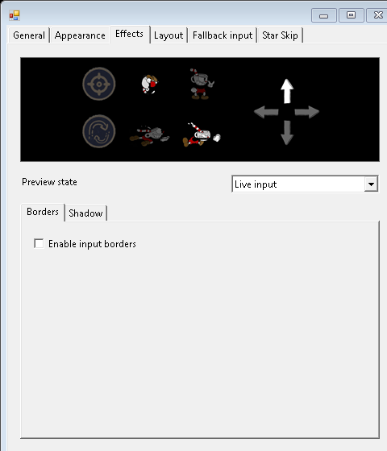
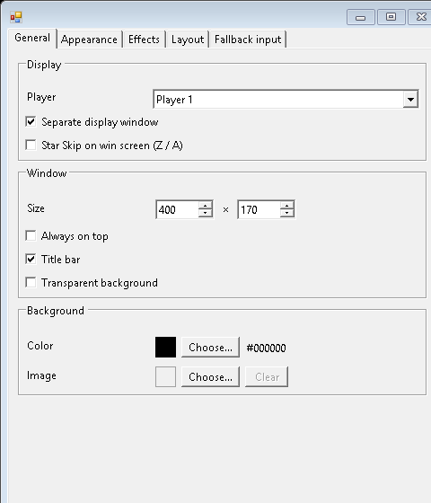

# LiveSplit.CupheadInputDisplay

Native Cuphead input-display component for LiveSplit. **One DLL**, embedded artwork, and standard Windows Forms settings. Based on [souldevss/CupheadInputDisplay](https://github.com/souldevss/CupheadInputDisplay).

## Install

1. Close LiveSplit.
2. Download [LiveSplit.CupheadInputDisplay.dll](dist/LiveSplit.CupheadInputDisplay.dll) using GitHub's download button.
3. Place the DLL in LiveSplit's `Components` directory, then reopen LiveSplit.
4. Choose **Edit Layout → + → Other → Cuphead Input Display**.
5. Configure it in **Layout Settings → Cuphead Input Display**.

The existing LiveSplit installation must provide `LiveSplit.Cuphead.dll`, `LiveSplit.Core.dll`, `UpdateManager.dll`, `SharpDX.dll`, `SharpDX.DirectInput.dll` and LiveSplit's existing `WinFormsColor.dll`. WebView2 is not used. No asset directory is installed.

## Features

- Always-on character and plane detection, including Ms. Chalice's active-player flag.
- Reads Cuphead's resolved in-game keyboard/controller action states automatically.
- Keyboard, XInput and DirectInput fallback bindings when game-state reading is unavailable.
- Native Windows Forms settings; no Config tab or separate settings window.
- Fully opaque solid background color with a native color picker. No gradients. General groups Display, Window and Background controls compactly and hides unused options.
- Background images embedded in the layout, with Fill, Fit, Stretch, Center and Tile sizing. PNG, JPG, BMP and static GIF input are supported; images are normalized to a maximum dimension of 2048 pixels.
- Compact 23×23 color swatches and **Choose…** buttons using LiveSplit's own color picker, including its screen eyedropper.
- Dark inactive / bright pressed appearance by default, with inversion.
- Independent inactive/pressed colors, brightness, opacity and 0–100% color strength.
- Original, multiply, colorize and solid coloring modes; per-element color overrides.
- Focused Effects sections for **Borders** and **Shadow**. Disabled effects hide their controls, and advanced shadow options are collapsed by default. Input backgrounds have been removed.
- Draggable artwork layout with per-element size, visibility and numeric offsets.
- Live-input previews by default, with isolated inactive/pressed simulations using the same renderer.
- Optional separate display window, reserving zero space in the splits layout.
- Window width/height, always-on-top and title-bar settings; window position is remembered.
- Settings save with the LiveSplit layout.

## Build

On Windows, run:

```powershell
.\build.ps1 -LiveSplitRoot 'C:\path\to\LiveSplit'
```

The script uses the Windows .NET Framework C# compiler and your existing LiveSplit assemblies. No .NET SDK or NuGet packages are needed. Output: `dist/LiveSplit.CupheadInputDisplay.dll`.

## Tests

```powershell
.\tests\run.ps1 -LiveSplitRoot 'C:\path\to\LiveSplit'
```

The native integration tests and rendering checks run locally on Windows. They create their own off-screen test window and write reports/previews under `artifacts/`.

Current version: **1.4.0**. The prepared build passed **225 checks**, including pixel-for-pixel preview/display comparisons in live, inactive and pressed modes. Live reading was also checked against a running Cuphead game reporting Cuphead / Plane with neutral input states. Physical controller presses and Ms. Chalice were not observed in that live check.

## Performance

One shared PNG is used for both input states; there are 41 embedded sprites (30 original inputs and 11 star animation frames) and no separate pressed-image copies. Effect masks and display-size rasterizations are cached. The display avoids redundant invalidations and skips fallback device polling while in-game input is available, except during fallback binding configuration or on the win screen while Star Skip is enabled.

A local 300-frame test measured approximately **0.34 ms per cached display render** with borders and shadows enabled. Cold effect generation took about **288 ms**. These measurements are machine- and settings-dependent and do not measure the entire LiveSplit application.

## References and credits

See [THIRD_PARTY.md](THIRD_PARTY.md) for artwork and reader references. Game memory is accessed read-only; the component does not inject code, execute game methods, change bindings, advance splits or alter game time.

## Effects settings

The preview remains above the Borders/Shadow sections. Enable an effect to reveal its controls; use **More shadow options…** for offsets, blur and spread. Existing settings are preserved while sections are collapsed.




## Separate display window

In **Layout Settings → Cuphead Input Display → General**, enable **Separate display window**. The display then occupies zero height/width in the LiveSplit layout. Configure window width, height, always-on-top and title-bar visibility in the same section. Move/resize the window normally; with its title bar hidden, drag its background to move it.

Closing the separate window switches back to the inline display. Removing the component or closing LiveSplit disposes the display window. Settings and artwork still use the same single DLL.



## True transparent window

Under **General**, enable **Separate display window**, then **Transparent background**. This uses a premultiplied 32-bit alpha surface and Windows [UpdateLayeredWindow](https://learn.microsoft.com/en-us/windows/win32/api/winuser/nf-winuser-updatelayeredwindow), not a chroma key or whole-window opacity. Background pixels are fully transparent while artwork and shadows retain their own alpha values.

Transparent mode hides the title bar and skips the solid/image background without deleting those settings. Drag a visible input sprite to move the window. Disabling transparency restores the saved title-bar/background preferences. The inline layout display remains opaque. Settings previews show a checkerboard behind transparent output.

## Pick a color from the screen

Click any swatch or **Choose…** to open LiveSplit's color picker. **Hold its eyedropper button, drag onto the screen color you want, then release.** Press OK to accept; Cancel restores the previous color. Swatches are fixed at 23×23 pixels, with the hex value shown separately.

Background-image selection now uses the same compact thumbnail-button interaction and file dialog as LiveSplit's built-in settings. Images remain embedded in the component's layout settings.

## Star Skip

Enable **General → Star Skip on win screen (Z / A)**. Cuphead’s current scene is read through the installed autosplitter’s scene reader. In **scene_win**, the star replaces all normal inputs; leaving that scene restores the normal display. It is off by default.

Star Skip always uses **Z** and **controller A**, independently of Cuphead or fallback jump bindings. Each new press plays all eight appearance frames, then resumes the three-frame main idle loop at approximately 12 fps. Quick taps finish the animation; holding a button does not repeatedly restart it. Layout → Star Skip provides visibility, position, scale and custom colors, with the existing effects applied to every frame. All artwork remains embedded in the single DLL.


Scene switching and inputs are covered by deterministic checks; this release’s win-screen transition has not been observed in a running game.
